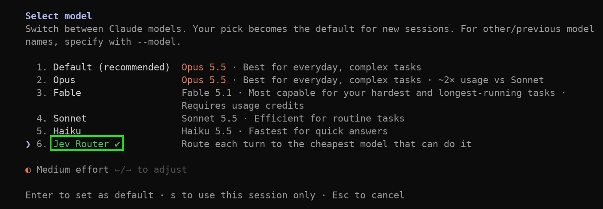
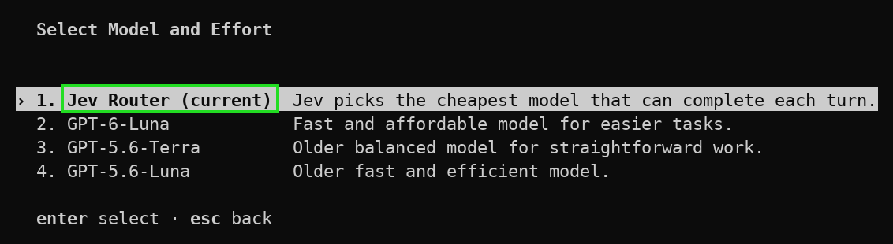

# jev-router-plus

[English](README.md) | 한국어

> [gargpratyush/jev-router](https://github.com/gargpratyush/jev-router)를 포크해 OpenRouter 지원, 계정별 모델 목록 반영, 단일 `jev` 명령 등을 추가한 버전입니다. 원본과 같은 환경변수·설정 파일을 씁니다.
>
> `npm install -g jev-router-plus`로 설치한 뒤 `jev`(Claude Code), `jev codex`, `jev explain`을 실행하세요. 명령 이름이 원본 `jev-router`와 달라서 둘을 충돌 없이 함께 설치할 수 있습니다.

Claude Code와 OpenAI Codex를 위한 턴 단위 자동 모델 라우팅입니다. Jev는 단순한 작업은
Fast 등급(tier)으로, 어려운 작업은 Strong 등급으로 보내며, 각 CLI 고유의 인터페이스·도구·세션·권한·인증은 그대로 유지합니다.

| 명령 | 인터페이스 | 인증 | 라우팅 결정 표시 |
| --- | --- | --- | --- |
| `jev` | Claude Code | 기존 `claude login` | 상태 표시줄 |
| `jev codex` | OpenAI Codex | 기존 `codex login` | 코멘터리 줄 |

두 명령 모두 실제 upstream CLI를 실행합니다. Jev는 새 사용자 턴에서 사용할 모델만 고릅니다.

## 빠른 시작

### 1. 요구 사항

- Node.js 20.12 이상.
- [Claude Code](https://code.claude.com/docs/en/setup) 및/또는
  [OpenAI Codex](https://developers.openai.com/codex/cli)가 이미 설치되고 로그인되어 있어야 합니다.
  구독 계정으로 로그인했다면 Anthropic이나 OpenAI API 키는 필요하지 않습니다.

### 2. npm으로 설치

```bash
npm install -g jev-router-plus
```

설치되는 명령은 `jev` 하나뿐이며, `jev`(Claude Code), `jev codex`, `jev explain`으로 쓰입니다.
원본 `jev-router` 패키지는 명령 이름이 달라서 둘을 충돌 없이 함께 설치할 수 있습니다.
다만 같은 `~/.jev-router.env` 파일과 환경변수를 공유합니다.
또한 두 패키지는 Codex 스킬을 같은 경로(`~/.agents/skills/jev-router-explain/SKILL.md`)에 설치하므로,
Codex를 마지막으로 실행한 패키지가 그 파일의 내용을 덮어씁니다.

소스에서 설치하려면 다음과 같이 합니다.

```bash
git clone https://github.com/seogineer/jev-router-plus.git
cd jev-router-plus
npm install
npm link
```

`npm link`를 하지 않았다면 체크아웃 디렉터리에서 `node bin/jev.mjs` 또는 `node bin/jev.mjs codex`를 실행하세요.
Codex의 `$jev-explain`은 이 경우에도 동작합니다. `jev codex`가 이 체크아웃의 `bin/explain.mjs` 절대 경로로
스킬을 설치하기 때문입니다. Claude Code의 `/jev-explain`도 `jev`가 체크아웃을 세션에 추가하므로 동작합니다.
`npm link`가 필요한 것은 셸 명령 `jev explain`뿐입니다.

### 3. 라우팅 키 설정

제공자를 하나 골라 해당 키를 `~/.jev-router.env`에 추가하세요. `...`는 실제 키로 바꿔야 하며, 자리표시자를 그대로 붙여 넣으면 안 됩니다.

옵션 A: [TypeSafe](https://docs.typesafe.ai)에서 발급받은 TypeSafe 키.

```bash
printf '\nJEV_API_KEY=...\n' >> ~/.jev-router.env
```

옵션 B: <https://openrouter.ai/keys>에서 발급받은 OpenRouter 키. OpenRouter 크레딧으로 결제됩니다.

```bash
printf '\nOPENROUTER_API_KEY=...\n' >> ~/.jev-router.env
```

Linux와 macOS에서는 파일 권한을 본인만 접근하도록 제한하세요.

```bash
chmod 600 ~/.jev-router.env
```

이는 디스크에 있는 파일만 보호합니다. 실행되는 CLI에 어떤 변수가 전달되는지는
[설정](#설정)에서 설명합니다.

Windows PowerShell에서는 옵션 A를 다음과 같이 합니다.

```powershell
Add-Content "$HOME\.jev-router.env" "`nJEV_API_KEY=..."
```

Windows PowerShell에서는 옵션 B를 다음과 같이 합니다.

```powershell
Add-Content "$HOME\.jev-router.env" "`nOPENROUTER_API_KEY=..."
```

두 키가 모두 설정되어 있으면 TypeSafe를 사용하며, OpenRouter를 쓰려면 `JEV_PROVIDER=openrouter`를 추가하세요.
키가 없으면 라우팅 없이 CLI가 시작됩니다. 셸에 이미 export된 환경변수는 파일보다 우선합니다.

### 4. 실행

어느 저장소에서든 원하는 인터페이스를 실행합니다.

```bash
jev
jev codex
```

모든 CLI 인자는 그대로 전달됩니다.

```bash
jev --resume
jev -p "fix the failing test"
jev codex resume --last
jev codex exec "fix the failing test"
```

`jev claude`는 `jev`와 같습니다. 첫 번째 인자가 `claude`, `codex`, `explain`이면 하위 명령으로 취급되며
CLI로 전달되지 않습니다.

`jev explain <session-id>`는 해당 세션의 라우팅 설명을 출력합니다. Claude Code에서 세션 ID는
세션 UUID이고, Codex에서는 `codex-<process-id>`입니다. 설명 스킬이 ID를 알아서 전달하므로
직접 입력할 일은 거의 없습니다. 인자 없이 실행하면 설치 확인용으로만 쓰이며, 자세한 내용은 아래를 참고하세요.

### 5. 확인, 업데이트, 삭제

```bash
jev explain
npm ls -g jev-router-plus
npm update -g jev-router-plus
npm uninstall -g jev-router-plus
```

인자 없는 `jev explain`은 세션을 읽지 않으므로 일반 셸에서는 라우팅 결정이 기록되지 않았다고 알리고
종료 코드 0으로 끝납니다. 명령이 설치되었는지 확인하는 용도로만 쓰세요. 실제 설명은 Claude Code에서 `/jev-explain`,
Codex에서 `$jev-explain`, 또는 `jev explain <session-id>`로 확인합니다.
설치 확인에 `jev --version`은 쓰지 마세요. Claude Code로 전달되어 Claude의 버전이 출력됩니다.

`npm uninstall`은 `jev codex`가 `~/.agents/skills/jev-router-explain/SKILL.md`에 쓴 Codex 스킬과
`~/.jev-router.env`를 지우지 않습니다. `~/.agents/skills/jev-router-explain` 디렉터리는 직접 삭제하세요
(Windows에서는 `%USERPROFILE%\.agents\skills\jev-router-explain`). `npm update`를 하면 다음에 `jev codex`를
실행할 때 스킬이 갱신됩니다.

방금 배포된 릴리스가 `npm install`이나 `npm update`로 설치되지 않으면 npm 캐시가 오래된 것입니다.
`npm install -g jev-router-plus@latest --prefer-online`을 실행하세요.

`/jev-explain`(Codex에서는 `$jev-explain`)에 `Decision: Jev key rejected; held`가 표시되면 제공자가
API 키를 거부한 것(HTTP 401/403)이며, 재시작하기 전까지 라우팅은 꺼진 상태로 유지됩니다.
`~/.jev-router.env`의 키(셸에서 export했다면 그 변수)를 고친 뒤 `jev` 또는 `jev codex`를
재시작하세요. 대화형 모드에서는 로그가 `~/.jev-claude.log`에 남고, `-p`에서는 stderr로 출력됩니다.

## Claude Code 인터페이스



이 스크린샷은 현재 릴리스보다 이전의 모델 이름과 표시를 보여 줍니다.

`jev`는 `/model`에서 **Jev Router**가 선택된 상태로 Claude Code를 실행합니다. 단, 직접
`ANTHROPIC_MODEL`을 설정했다면 그 값이 우선하므로 Jev Router로 시작하지 않습니다.
다른 모델을 선택하면 라우팅이 일시 중지되고, **Jev Router**를 다시 선택하면 재개됩니다.

주입된 상태 표시줄에는 직전 턴에 사용한 정확한 모델이 표시되고, 괄호 안에 Jev의 신뢰도가 붙습니다.
정책이 Jev의 추천을 그대로 따르지 않았을 때만 괄호 안에 그 이유가 표시됩니다. 첫 프롬프트 전에는
대기 메시지가, 수동으로 모델을 선택한 뒤에는 선택한 모델이 표시됩니다.

```text
jev: waiting for first prompt · my-project · 0% context
claude-haiku-5-5 (p=0.98) · my-project · 8% context
claude-sonnet-5-5 (p=0.25) (low-confidence-capped) · my-project · 8% context
⏸ manual Opus 5.5 · my-project · 21% context
```

`jev`는 실행하는 Claude Code 세션에서 몇 가지를 바꿉니다. 패키지 디렉터리에 대한 `--add-dir`을 항상
추가하며, 이곳에 번들된 `/jev-explain` 스킬이 있습니다. 라우팅이 켜져 있으면 `ANTHROPIC_BASE_URL`을
로컬 프록시로 지정하고, 모델 선택기에 **Jev Router** 행을 추가해 선택하며,
`CLAUDE_CODE_ENABLE_GATEWAY_MODEL_DISCOVERY=1`과
`CLAUDE_CODE_DISABLE_UNKNOWN_MODEL_WINDOW_ENFORCEMENT=1`을 설정합니다. 이미 설정해 두지 않았다면
`CLAUDE_CODE_MAX_CONTEXT_TOKENS=1000000`과 `ENABLE_TOOL_SEARCH=true`도 설정합니다. 그 외의 Claude Code
동작은 그대로입니다. 기존 사용자 지정 `statusLine`은 유지되며, Jev의 상태 표시줄을 끄려면
`JEV_NO_STATUSLINE=1`을 설정하세요.

**Jev Router**가 선택된 동안 Claude Code(2.1.309에서 확인)는 `jev-router`가 자체 모델 카탈로그에 없기 때문에 `Warning: Advisor disabled — base model 'jev-router' has no advisor rank …`와 `[claude-code:unrecognized_model]`을 출력합니다. 예상된 알림이며 라우팅은 정상 동작합니다(`-p` 모드의 stderr에서 확인).

설명 스킬은 npm 패키지에 포함되어 자동으로 로드됩니다. `jev`에서는 `/jev-explain`을,
`jev codex`에서는 `$jev-explain`을 실행하면 직전 라우팅 결정의 근거를 볼 수 있습니다.

```text
┌──────────────────────────────────────────────┐
│ Jev Router                                   │
│                                              │
│ Jev request                                  │
│ Prompt: explain the router                   │
│ Current tier: haiku                          │
│ Context tokens: 6200                         │
│                                              │
│ Jev response                                 │
│ Task complexity     0.82                     │
│ Reasoning required  0.91                     │
│ Tool complexity     0.64                     │
│ Context size        0.31                     │
│                                              │
│ Recommended tier: SONNET                     │
│ Selected model: claude-sonnet-5-5            │
│                                              │
│ Confidence: 94%                              │
│ Decision: Jev recommendation                 │
└──────────────────────────────────────────────┘
```

이 보고서는 라우팅이 일어났을 때 저장된 정확한 프롬프트, System One 요청, System One
응답으로 로컬에서 생성됩니다. 최근 결정은 CLI 세션별로 보관되며, 설명 스킬을 호출해도
Jev에 프롬프트를 다시 평가해 달라고 요청하지 않습니다.

### 설명 데이터 위치

`jev`와 `jev codex` 모두 최근 라우팅 교환을 최대 20개까지, CLI 세션마다 JSON 파일 하나로
Node.js가 사용하는 운영체제 임시 디렉터리 아래에 보관합니다.

| 플랫폼 | 기본 위치 |
| --- | --- |
| Windows | `%TEMP%\jev-claude\<session-id>.json` |
| macOS | `$TMPDIR/jev-claude/<session-id>.json` (보통 `/var/folders/.../T` 아래) |
| Ubuntu/Linux | `${TMPDIR:-/tmp}/jev-claude/<session-id>.json` |

현재 컴퓨터에서 실제로 선택된 디렉터리는 다음 명령으로 출력할 수 있습니다.

```bash
node -e "console.log(require('node:path').join(require('node:os').tmpdir(), 'jev-claude'))"
```

Claude 파일명은 Claude Code의 세션 UUID를 사용하고, Codex 파일명은
`codex-<process-id>.json`을 사용합니다. 이 임시 파일에는 프롬프트 텍스트와 Jev의 정확한
요청·응답이 들어 있으므로 본인만 읽을 수 있습니다(디렉터리는 권한 700, 각 파일은 600으로 생성됩니다). 7일 동안 갱신되지 않은 파일은 자동으로 삭제되며,
운영체제의 일반적인 임시 파일 정리 과정에서 삭제될 수도 있습니다.

> `Enter`로 모델을 선택하면 그 모델이 Claude Code의 기본값으로 저장될 수 있습니다. `jev`는 정상 종료하거나
> SIGTERM·SIGHUP을 받으면 이전 기본값을 복원합니다. SIGKILL로 강제 종료되면 `jev-router` 항목이
> Claude Code 설정에 남을 수 있고, 일반 `claude`는 이를 해석하지 못합니다. 라우팅이 켜진 다음 `jev` 세션이 끝날 때 정리됩니다.

## OpenAI Codex 인터페이스



이 스크린샷은 현재 릴리스보다 이전의 모델 이름을 보여 줍니다. 선택기에는 라우팅 항목이
`jev-router`로 표시됩니다.

`jev codex`는 임시 **Jev Router** 프로바이더로 Codex를 실행하고 `jev-router`를 선택합니다.
네이티브 `/model` 선택기에는 계정에서 사용할 수 있는 모델이 그대로 표시됩니다. 특정
모델을 선택하면 라우팅이 일시 중지되고, `jev-router`를 다시 선택하면 재개됩니다.

새 결정이 있을 때마다 Codex 코멘터리로 표시됩니다.

```text
[Jev] routed this turn to gpt-5.6-sol (jev, confidence 0.91).
```

`jev codex`는 시작할 때 패키지에 포함된 `$jev-explain` 스킬을 설치하거나 갱신하므로,
별도 설정 없이 어느 저장소에서든 사용할 수 있습니다.

Codex의 푸터에는 `jev-router`가 표시되는데, 이는 해당 프로바이더 뒤에서 실제로 고른 모델이 아니라
선택기에서 선택한 항목을 보여 주기 때문입니다.

Jev 호출이 실패하면 코멘터리에 `[Jev] unavailable; using <model>`이 표시되고, 계속 사용되는 모델이
적히며, `JEV_API_KEY` 또는 `OPENROUTER_API_KEY`를 설정하는 방법이 안내됩니다. 이 메시지는 키가 설정되어
있을 때만 나타나므로, 키가 없다는 뜻이 아니라 호출 자체가 실패했다는 뜻입니다(네트워크 오류, 타임아웃,
거부된 키, 사용할 수 없는 응답). 키가 없으면 `jev codex`는 시작할 때 경고를 출력하고 라우팅 없이
Codex를 실행합니다.

`jev codex`는 계정의 Codex 카탈로그에 있는 모델 중 등급에 매핑되는 모든 모델을 Jev에 보냅니다.
`jev-router` 항목과 API가 지원하지 않는 모델은 제외합니다. 모델이 `JEV_CODEX_*` 변수에 설정된 모델과 같으면
그 등급이 되고, 그렇지 않으면 이름으로 정하며 다음 순서로 확인합니다. 이름에 `astra`, `fable`, `long`이 들어 있으면
Long, `sol`, `opus`, `strong`, `max`, `pro`가 들어 있으면 Strong, `luna`, `haiku`, `fast`, `mini`, `nano`가 들어 있으면
Fast이고, 그 외의 `gpt-` 모델은 Balanced입니다. `JEV_CODEX_*` 변수를 빈 문자열로 설정하면 기본값 대신
빈 문자열이 모델 이름으로 쓰입니다.

`jev`와 달리 `jev codex`는 첫 턴에도 실제 컨텍스트 크기를 정책에 전달하므로, 큰 첫 프롬프트에 대한
첫 턴 등급 하향은 프롬프트 캐시 가드에 막힐 수 있습니다.

## 동작 방식

각 명령은 루프백 프록시를 시작하고 실제 CLI를 실행하며, CLI가 가진 기존
인증 헤더를 읽거나 저장하거나 수정하지 않고 그대로 전달합니다.

```text
you -> Claude Code -> jev proxy -> Anthropic
                         |
                         +-> Jev: choose a tier

you -> OpenAI Codex -> jev codex proxy -> OpenAI
                         |
                         +-> Jev: choose a tier
```

Claude Code는 `ANTHROPIC_BASE_URL`을 사용하고, Codex는 `requires_openai_auth=true`가 설정된
임시 사용자 지정 프로바이더를 사용합니다. Claude와 Codex 모두 `jev-router`를
라우팅 센티널로 사용합니다.
사용자가 선택한 구체적인 모델은 그대로 통과합니다.

## 라우팅 정책

새 사용자 턴마다 Jev를 한 번 호출해 공통 추상 등급(tier) 하나를 선택합니다.

| 등급 | Claude Code 기본값 | Codex 기본값 |
| --- | --- | --- |
| Fast | Haiku | `gpt-5.6-luna` |
| Balanced | Sonnet | `gpt-5.6-terra` |
| Strong | Opus | `gpt-5.6-sol` |
| Long | Fable | `gpt-6-astra` |

이후 `src/policy.mjs`가 다음 규칙을 적용합니다.

- `use opus`, `use luna`, `use strong` 같은 명시적 요청이 우선합니다.
- 실패, 타임아웃, 또는 인식할 수 없는 Jev 응답이 나오면 현재 모델을 유지합니다.
- 신뢰도가 낮으면 등급을 낮추지 않으며, 올리더라도 Balanced 등급까지만 올립니다.
- 대화가 크면, 절약하는 양보다 프롬프트 캐시 작업을 더 낭비하게 되는 등급 하향은 거부합니다.
- 사용할 수 없는 등급은 조용히 더 약한 모델을 고르지 않고 사용 가능한 다음 높은 등급으로 올립니다.
  단, 요청하지 않았다면 Long 등급으로는 올리지 않으며, 더 높은 등급이 없을 때만 내립니다.
- Long 등급은 `JEV_ALLOW_FABLE=1`을 설정하지 않으면 비활성화됩니다.

도구 루프의 이어지는 요청은 턴 시작 시 선택한 등급을 유지합니다. 메인 대화와
서브 에이전트는 각각 따로 고정됩니다. 라우팅은 fail-open입니다. Jev가 실패해도 CLI는 막히지 않습니다.

## 설정

| 변수 | 인터페이스 | 효과 |
| --- | --- | --- |
| `JEV_API_KEY` | 둘 다 | TypeSafe를 통한 라우팅을 켭니다. `TYPESAFE_API_KEY`도 사용할 수 있습니다. |
| `TYPESAFE_DEFAULT_MODEL` | 둘 다 | 각 라우팅 요청과 함께 TypeSafe에 보내는 모델 이름입니다. TypeSafe SDK가 읽으며 기본값은 `jev-latest`입니다. OpenRouter는 대신 `JEV_OPENROUTER_MODEL`을 사용합니다. |
| `TYPESAFE_BASE_URL` | 둘 다 | 라우팅 결정을 `https://api.typesafe.ai` 대신 다른 System-One 서버로 보냅니다. 예를 들어 `POST /v1/systemone`을 제공하는 자체 호스팅 [Laya](https://github.com/NandhaKishorM/laya)가 있습니다. `JEV_API_KEY`는 여전히 필요하며 해당 서버에 bearer 토큰으로 전송됩니다. OpenRouter는 대신 `JEV_OPENROUTER_URL`을 사용합니다. |
| `OPENROUTER_API_KEY` | 둘 다 | TypeSafe 키가 없을 때 OpenRouter를 통한 라우팅을 켭니다. |
| `JEV_PROVIDER` | 둘 다 | 두 키가 모두 있을 때 `typesafe` 또는 `openrouter`를 강제합니다. |
| `JEV_OPENROUTER_MODEL` | 둘 다 | OpenRouter 모델 id입니다. 기본값은 `typesafe/jev-1.13`입니다. |
| `JEV_OPENROUTER_URL` | 둘 다 | OpenRouter 결정 엔드포인트입니다. 기본값은 `https://openrouter.ai/api/alpha/decisions`입니다. |
| `JEV_ALLOW_FABLE` | 둘 다 | 선택 사항인 Long 등급을 켭니다. |
| `JEV_DEBUG` | 둘 다 | 결정과 재작성 내용을 로그에 추가로 기록합니다. 라우팅 실패는 이 변수가 없어도 항상 기록됩니다. 로그는 `~/.jev-claude.log`이며, stdout이 터미널이 아니면(예: 파이프하거나 캡처한 `jev -p`) 대신 stderr로 출력됩니다. |
| `JEV_DUMP` | 둘 다 | 파일 이름 접두사입니다. 프롬프트와 코드를 포함한 모든 요청 본문이 기본 파일 권한으로 `<prefix>.<timestamp>.json`에 기록됩니다. 와이어 포맷 변경을 디버깅할 때만 사용하고, 끝나면 파일을 삭제하세요. |
| `JEV_NO_STATUSLINE` | Claude | 주입되는 Claude 상태 표시줄을 끕니다. |
| `JEV_CODEX_FAST_MODEL` | Codex | Fast 모델입니다. 기본값은 `gpt-5.6-luna`입니다. |
| `JEV_CODEX_BALANCED_MODEL` | Codex | Balanced 모델입니다. 기본값은 `gpt-5.6-terra`입니다. |
| `JEV_CODEX_STRONG_MODEL` | Codex | Strong 모델입니다. 기본값은 `gpt-5.6-sol`입니다. |
| `JEV_CODEX_LONG_MODEL` | Codex | Long 모델입니다. 기본값은 `gpt-6-astra`입니다. |

이미 설정된 환경변수가 가장 높은 우선순위를 가지며, 그다음이 실행 디렉터리의 `.env`,
`~/.jev-router.env`, 레거시 `~/.jev-claude.env` 순입니다.

이 파일들에서 읽어 들인 라우팅 키(`JEV_API_KEY`, `TYPESAFE_API_KEY`, `OPENROUTER_API_KEY`)는 실행되는 CLI의
환경에서 제거되므로, CLI와 CLI가 실행하는 도구에는 보이지 않습니다. 셸에서 직접 export한 키는 그대로 전달되며,
이 파일들의 다른 모든 변수도 전달됩니다. 실행 디렉터리의 `.env`는 통째로 로드되므로, 신뢰하는
저장소에서만 `jev`를 실행하세요.

등급 정의, Jev에 던지는 질문, 신뢰도 임계값, 타임아웃은 `src/config.mjs`에 있습니다.
`jev`는 로그인한 계정의 네이티브 카탈로그에 있는 정확한 Claude 모델을 Jev에 보내며,
등급마다 가장 최신 모델만 남깁니다(예: `claude-opus-4-8`은 제외하고 `claude-opus-5-5`만 사용).
`jev codex`는 카탈로그에서 등급에 매핑되는 모든 모델을 보냅니다(위의 Codex 절 참고).
정적 모델 id는 카탈로그를 가져오기 전까지만 사용됩니다.

## 호환성 참고

- Claude Code는 사용자 지정 base URL이 활성화되어 있을 때, 오래된 MCP JSON Schema 필드에 대한
  스키마 정규화가 필요합니다.
- Haiku의 adaptive thinking처럼 라우팅된 등급이 지원하지 않는 Claude 요청 필드는
  전달하기 전에 제거됩니다.
- Codex의 현재 요청 형식은 도구 정의를 Responses API 입력 안에 저장합니다.
- Codex의 ChatGPT 백엔드는 `Content-Type` 헤더 없이 SSE를 스트리밍할 수 있으므로, 프록시는
  첫 프레임으로 이벤트 스트림을 감지합니다.
- Codex의 워크스페이스별 엔터프라이즈 origin은 내장 프로바이더 내부 전용이라
  사용자 지정 프로바이더로는 재현할 수 없습니다.

## 개발

```bash
npm install
echo "JEV_API_KEY=..." > .env

npm test
node test/live-routing.mjs
node bin/jev.mjs -p "what is 2+2?"
node bin/jev.mjs codex exec "what is 2+2?"
```

위의 `echo` 줄은 체크아웃에 이미 있는 `.env`를 덮어씁니다. 기존 파일에 추가하려면 `>>`를 사용하세요.

테스트 스위트는 공통 정책, 두 가지 요청 형식, 모델 재작성, 기능 처리,
설정 복원, Codex 인증 전달, 네이티브 모델 선택기 주입, 결정 표시를 다룹니다.

## 제한 사항

- 라우팅 결정마다 TypeSafe(`TYPESAFE_BASE_URL`이 설정된 경우 해당 서버), 또는 OpenRouter 프로바이더를
  선택한 경우 OpenRouter가 프롬프트 텍스트, 현재 사용 중인 모델, 추정 컨텍스트 크기(토큰),
  라우팅에 사용할 수 있는 모델의 id와 설명을 받습니다.
- 자체 호스팅 Laya는 `confidence`를 선택한 옵션의 확률이 아니라 정규화된 엔트로피 `1 - H(p)/log k`로
  보고하므로, `THRESHOLDS.minConfidence`도 그 척도로 해석됩니다. 의존하기 전에 직접 운영하는
  서버에서 확인하세요.
- `JEV_API_KEY`와 `OPENROUTER_API_KEY`가 모두 설정되어 있으면 TypeSafe를 사용하며, OpenRouter는
  `JEV_PROVIDER=openrouter`일 때만 켜집니다. `JEV_PROVIDER` 값이 잘못되었거나 선택한
  프로바이더의 키가 없으면 (경고와 함께) 라우팅 없이 CLI를 시작합니다. 셸에서 export한
  변수가 `~/.jev-router.env`보다 우선합니다.
- Jev는 턴의 첫 요청에만 지연을 더하며, 도구 루프의 이어지는 요청에는 지연이 없습니다.
- Claude Code와 Codex의 요청 형식은 공개된 규약이 아닙니다. upstream 변경을 진단하려면 `JEV_DUMP`를 사용하세요.
- 이 포크는 Linux(Node 24)에서 Claude Code 2.1.309로 끝까지 확인했습니다. Codex 실행기는 Codex CLI 0.153.4가
  설치된 상태와 테스트의 가짜 CLI로만 시험했으며, 실제 Codex 세션을 통한 라우팅은 검증하지 않았습니다. 원 프로젝트는
  Windows에서 Claude Code v2.1.101과 OpenAI Codex v0.154.0을 기준으로 개발되었습니다. 이 포크의 Windows와
  macOS 동작은 검증하지 않았습니다.

## 기여

이슈와 풀 리퀘스트를 환영합니다. 버그 신고, 개선 요청, 질문은 [Issues](https://github.com/seogineer/jev-router-plus/issues)를 이용하세요.
관련 Claude Code 또는 Codex 버전, 재현 절차, 기대 동작, 비밀 정보를 제거한 유용한 로그를 함께 적어 주세요.

풀 리퀘스트를 보낼 때는 다음을 지켜 주세요.

1. 먼저 이슈를 여세요. 기여자의 모든 PR은 승인된 이슈와 연결되어야 합니다. 이슈 설명에 문제와 검증 방법을 적어 주세요.
2. 저장소를 포크하고 `master`에서 목적이 분명한 브랜치를 만드세요.
3. 문제를 해결하는 가장 작은 변경만 하세요.
4. `npm test`를 실행하고, 사소하지 않은 동작 변경에는 테스트를 포함하세요.
5. Claude/Copilot/Codex는 기여자가 될 수 없습니다.

API 키나 그 밖의 비밀 정보는 커밋하지 마세요. 모든 기여는 리뷰를 거쳐야 하며, 풀 리퀘스트는
저장소 소유자만 병합할 수 있습니다.

## 라이선스

MIT
